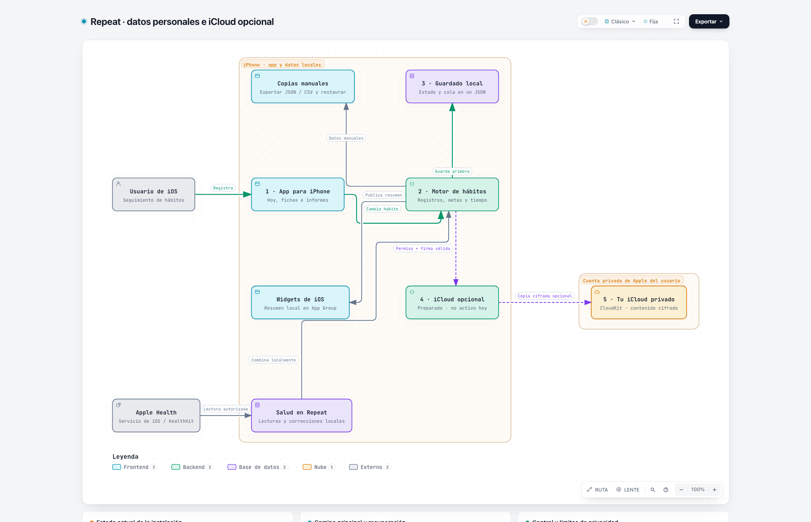

# Arquitectura de Repeat: privacidad e iCloud opcional

La app móvil guarda primero en el iPhone. El diagrama muestra diez componentes y separa el recorrido local operativo de la integración privada de iCloud preparada en el código.

**Estado de la instalación actual:** Repeat 1.7 está instalada en modo local. La firma gratuita de Apple no permite activar iCloud; todavía no hay una copia subida ni una recuperación real verificada con esta integración. La exportación y restauración manual siguen disponibles.

- [Diagrama interactivo](repeat.html): descarga el archivo y ábrelo en un navegador; GitHub muestra el código HTML.
- [Fuente editable de Archify](repeat.architecture.json).
- [Código de referencia](https://github.com/adrianrrruiz/Repeat/tree/2ff18f6fa4e1c1a5e7e1311a91d8b1af9dd9ca42).
- [Configuración y verificación de iOS](../../ios/README.md).

El camino principal registra un hábito, actualiza el motor y guarda estado y operaciones pendientes juntos. La rama iCloud solo puede operar con firma compatible, contenedor/esquema configurados y consentimiento explícito. Usa la base privada de la cuenta de Apple, con el contenido en campos cifrados y recibos para evitar duplicados en reintentos. No utiliza un servidor propio de Repeat para los hábitos.

Las lecturas y correcciones de Apple Health permanecen en el iPhone y se excluyen de esta sincronización y de las exportaciones normales. Los widgets leen un resumen local del App Group. La persona puede exportar/restaurar manualmente; la integración preparada permite desactivar iCloud y confirmar el borrado de la copia remota conservando sus hábitos locales.

La app nativa retiró la sincronización y autenticación con Sites/OpenAI/Cloudflare. La web anterior sigue separada y esta actualización no borró sus datos ni modificó su audiencia. Una app para Mac/Windows o análisis web queda para después.

Pendiente: subida y descifrado reales en CloudKit, recuperación en otro iPhone, cuota, conflictos entre dispositivos y borrado remoto. La sincronización no es un historial de respaldos y no protege cambios todavía pendientes de enviar.

Generado con Archify. Las referencias de archivo y línea de cada componente se conservan en el JSON y el visor. El HTML pasa comprobaciones automáticas del artefacto y navegador; la vista previa corresponde a esta entrega.
